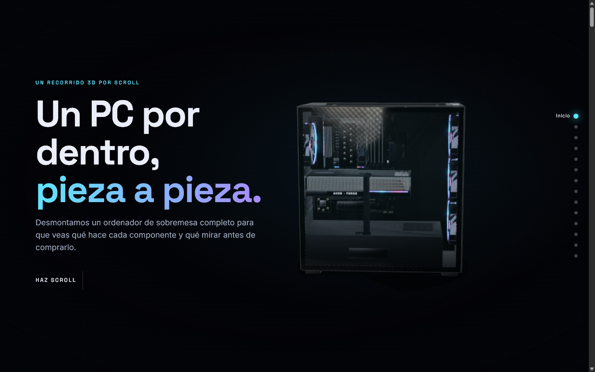
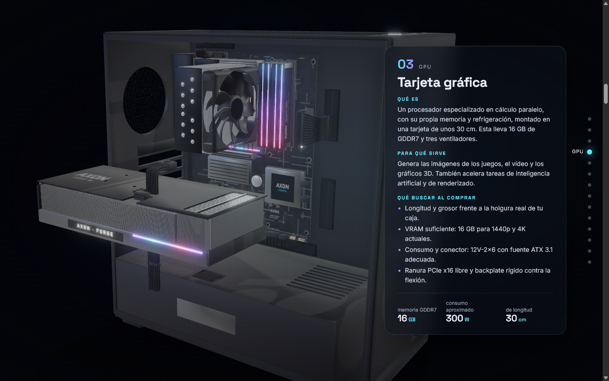
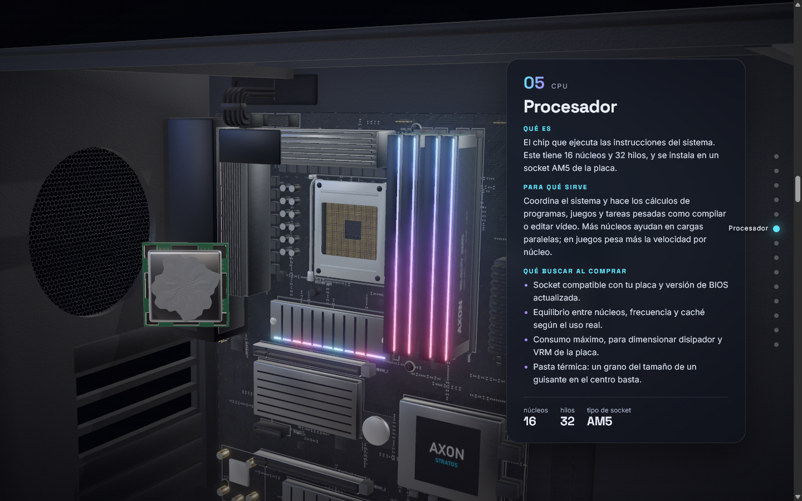
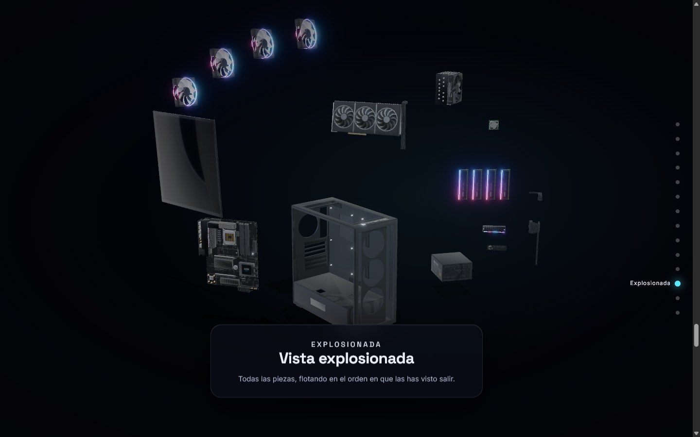

# PC desmontado

**Un PC de sobremesa que se desmonta pieza a pieza mientras haces scroll.**

Web en español con una experiencia 3D interactiva: al bajar, cada componente sale de su sitio en su
dirección real de montaje y aparece un panel con **qué es, para qué sirve y qué mirar al comprarlo**.
Al final todas las piezas flotan en una vista explosionada y, si sigues bajando, el PC se vuelve a
montar. Hacia arriba, todo va en reversa.

🔗 **Demo:** https://pc-desmontado.vercel.app



| | | |
|:-:|:-:|:-:|
|  |  |  |
| Tarjeta gráfica | CPU y pasta térmica | Vista explosionada |

## Qué tiene

- **10 pasos de desmontaje:** panel de cristal → ventiladores → GPU → disipador → CPU (con la pasta
  térmica visible) → RAM → SSD NVMe M.2 → fuente → placa base → caja vacía.
- **Modelo con proporciones reales**, hecho 100 % con scripts de Python en Blender: placa ATX de
  305 × 244 mm con socket AM5, VRM, ranuras DIMM/PCIe/M.2 y serigrafía alineada al milímetro; GPU de
  305 mm con backplate, heatpipes y conector 12V-2x6; disipador de torre con 6 heatpipes de cobre;
  cables de 24 pines, EPS y PCIe con hilos individuales.
- **Materiales PBR**, iluminación de estudio con HDRI, bloom en los RGB, tone mapping AgX y
  oclusión ambiental en tiempo real.
- **Ligera:** el modelo pesa 2,6 MB (1,8 MB en móvil) gracias a meshopt + texturas WebP.
- **Versión móvil**, scroll suave, navegación por secciones y accesible con teclado.

## Arrancar en local

Necesitas [Node.js](https://nodejs.org/) 20 o superior.

```bash
git clone https://github.com/brandon03-cell/pc-desmontado.git
cd pc-desmontado
npm install
npm run dev        # http://localhost:5173
```

```bash
npm run build      # build de producción en dist/
npm run preview    # sirve dist/
```

## Stack

- Vite + React + TypeScript
- three.js · @react-three/fiber · @react-three/drei · @react-three/postprocessing
- GSAP ScrollTrigger (una única timeline con `scrub`) + Lenis (scroll suave)
- Modelo: Blender 5.2 por scripts → GLB → gltf-transform (meshopt + WebP)

## Estructura

```
blender/scripts/   Modelado procedural (un script por pieza) + materiales PBR + export GLB
blender/pc.blend   Escena de Blender generada por los scripts
blender/renders/   Renders de revisión
tools/             gen_textures.py (texturas con PIL) · optimize-glb.mjs (meshopt + WebP)
assets-src/        Texturas fuente y HDRI 2k
public/models/     pc.glb (escritorio) y pc-mobile.glb (texturas a 1024 px)
src/scene/         parts.ts (contrato de nodos), choreography.ts (coreografía), escena R3F
src/scroll/        Timeline GSAP + Lenis
src/ui/            Loader, portada, paneles, navegación y cierre
src/content/       Textos de cada pieza
docs/              Arquitectura y capturas
```

Más detalle en [docs/ARQUITECTURA.md](docs/ARQUITECTURA.md).

## Regenerar el modelo

Solo hace falta si cambias la geometría o las texturas; el GLB ya está en `public/models/`.

1. Texturas: `python tools/gen_textures.py` (requiere Pillow y NumPy)
2. En Blender 5.2, con `blender/pc.blend` abierto, en la consola de Python:
   ```python
   exec(open(r"blender/scripts/run.py").read()); build()          # todas las piezas
   exec(open(r"blender/scripts/export_glb.py").read()); export()  # → assets-src/pc_raw.glb
   ```
3. `npm run assets:optimize` → `public/models/pc.glb` y `pc-mobile.glb`

Las cotas compartidas de la placa (socket, DIMM, PCIe, M.2…) están en `blender/scripts/layout.py`;
las usan tanto el modelado como la serigrafía generada, para que coincidan al milímetro. No edites
el `.blend` a mano: los scripts son la fuente de verdad y el export comprueba que nada se haya movido.

## Afinar la coreografía

Todo está en `src/scene/choreography.ts`: cámara por paso, despegue (`lift`) y posición flotante
(`exploded`) de cada pieza, y tiempos (`TIMING`). Los textos están en `src/content/piezas.ts`.

## Créditos

La marca «AXON» de la placa es ficticia. El único recurso externo es el HDRI *Studio Small 09* de
Poly Haven (CC0). Ver [CREDITS.md](CREDITS.md).
